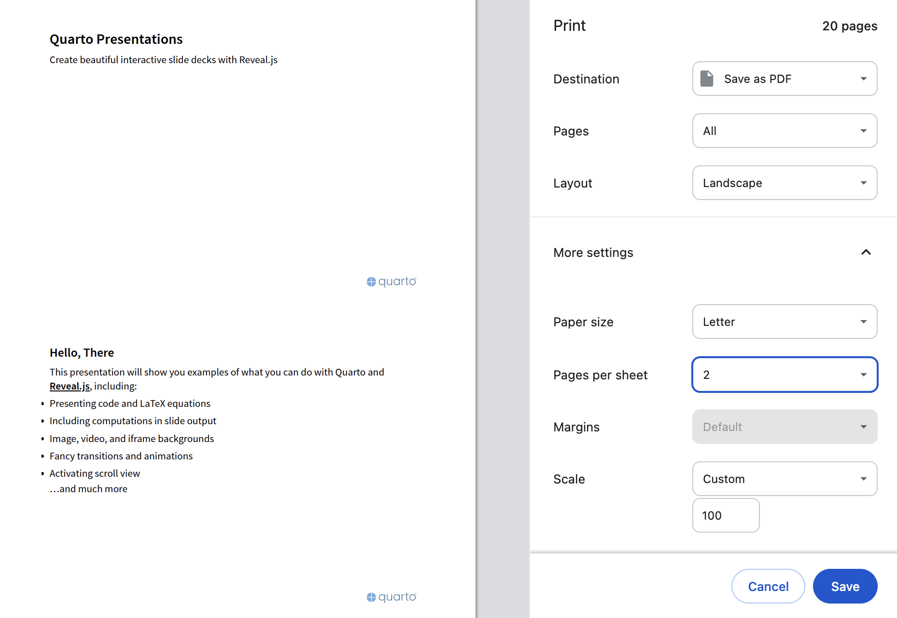

# **Quarto presentation** {.unnumbered}

With [Quarto](https://quarto.org/#:~:text=An%20open%2Dsource%20scientific%20and%20technical%20publishing%20system), you can turn Quarto markdown (qmd) files into documents like articles or reports, websites such as blogs, and different kinds of presentations including sales pitches.

Like other digital deliverables created by Quarto, presentations can be rendered as [HTML](https://en.wikipedia.org/wiki/HTML#:~:text=the%20standard%20markup%20language%5Ba%5D%20for%20documents%20designed%20to%20be%20displayed%20in%20a%20web%20browser), viewed in a web browser, and saved as a [PDF](https://en.wikipedia.org/wiki/PDF#:~:text=a%20file%20format%20developed%20by%20Adobe%20in%201993%20used%20to%20present%20documents) using the print dialog.

Before saving, we should make sure the Layout is set to Landscape.

{style="border-color: gray;border-style: solid;"}

A PDF presentation should have only one slide per page, but putting multiple slides on one page may be convenient if we want to read the slides instead of presenting them.



For best results, I suggest following the PDF export instructions in the [RevealJS](https://revealjs.com) documentation: <https://revealjs.com/pdf-export/>.

PDF files are ubiquitous and it is good to know that you can generate one with nothing more than a web browser whenever necessary, but HTML files can do many things that PDF files simply cannot.

The example presentation below shows what is expected for the Research Presentation assignment. It covers chi-square (&chi;^2^) testing in genetics from Chapter 11 of the lab manual and models each part of the rubric:

- **Scientific content and research quality:** accurate explanations supported by academic sources, including a human genetics example
- **Organization and structure:** a clear introduction, body, and conclusion
- **Visual aids:** labeled figures and tables, readable slides, and citations on the slides and in a references slide
- **Oral delivery:** speaker notes on every slide (press <kbd>S</kbd> while viewing the HTML presentation to open the speaker view)
- **Submission and accessibility:** a working web link to both an HTML and a PDF version

The equations are written in [LaTeX](https://en.wikipedia.org/wiki/LaTeX#:~:text=a%20software%20system%20for%20typesetting%20documents) (e.g., `$\chi^2$`), and the R output and figures are embedded from a Jupyter notebook, [chisq.ipynb](demo/chisq.ipynb), that was run locally before the presentation was published. Because the notebook's output is saved in the notebook itself, the website can be built without installing R.

The HTML presentation is shown first, followed by the PDF version.

::: {}
```{=html}
<iframe class="slide-deck" src="demo/" width="100%"></iframe>
```
:::

::: {}
```{=html}
<iframe class="slide-deck" src="demo/demo.pdf" width="100%"></iframe>
```
:::

Instead of embedding your presentation in a webpage as shown above, you can view it in its own browser tab in [HTML](demo/) or [PDF](demo/demo.pdf) format.

To edit a presentation, you can modify the plain text of the associated qmd file in a [text editor](https://en.wikipedia.org/wiki/Text_editor) or work with a [WYSIWYG](https://en.wikipedia.org/wiki/WYSIWYG) version via the [Visual Mode](https://docs.posit.co/ide/user/ide/guide/documents/visual-editor.html) in RStudio, VSCode, Codespaces, or Positron.

When you want to update the presentation on your website, all you have to do is add, commit, and push your changes. It may take some time for your site to update after you push changes. You can see the status and logs of all of your website builds in the Actions tab of your repo on <www.github.com>.
